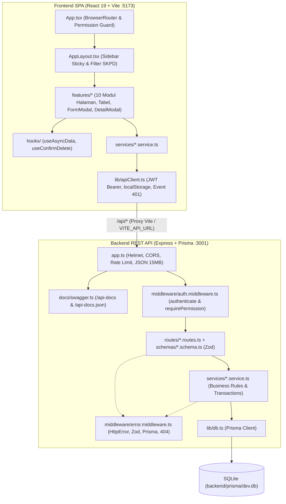
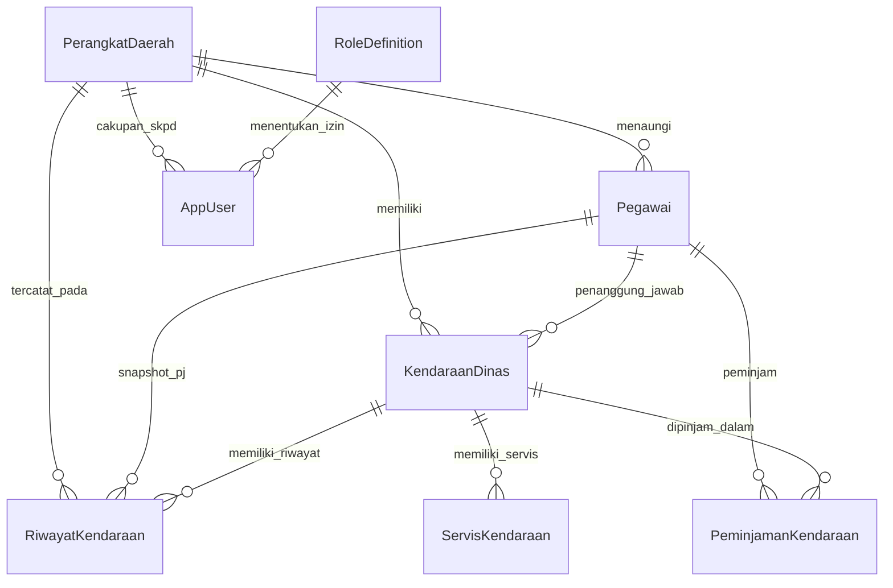
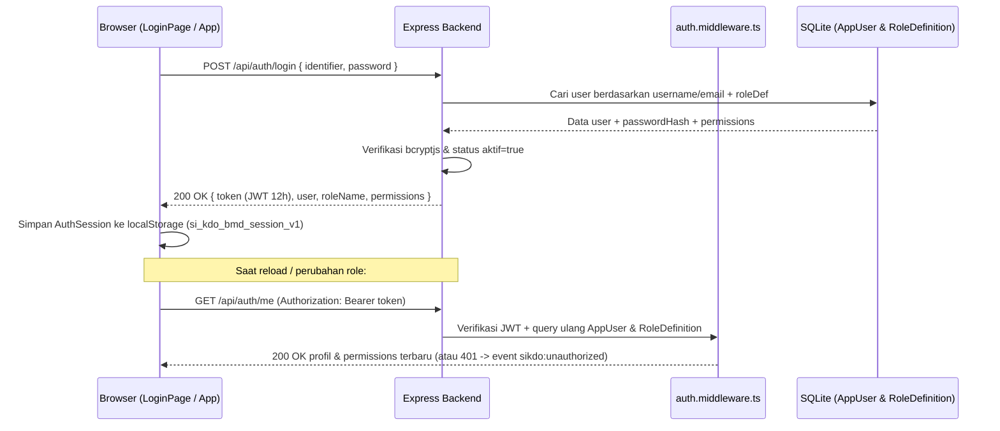
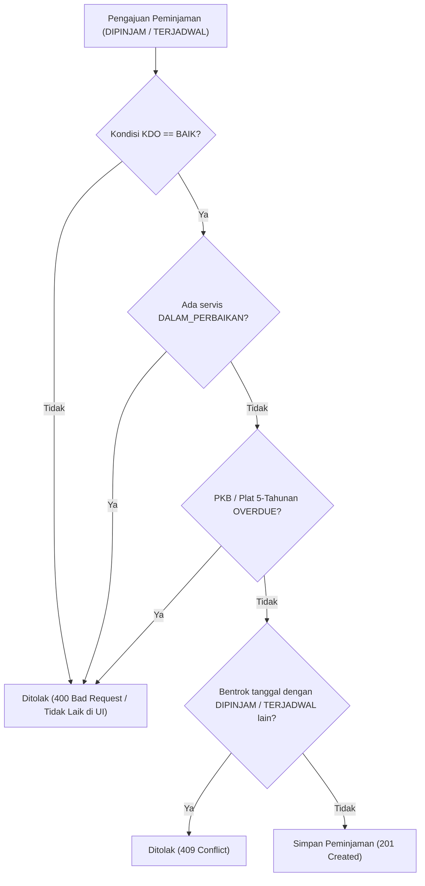

# Dokumentasi Teknis Menyeluruh (Backend & Frontend) — SI-KDO BMD

Dokumen ini menjelaskan arsitektur end-to-end, skema basis data, mekanisme autentikasi dan RBAC dinamis, aturan bisnis domain, kontrak REST API backend, serta struktur modul dan komponen frontend pada aplikasi **Sistem Pengelolaan Kendaraan Dinas Operasional (SI-KDO BMD)** untuk **BPAD DKI Jakarta**.

---

## Daftar Isi

1. [Gambaran Umum & Arsitektur End-to-End](#1-gambaran-umum--arsitektur-end-to-end)
2. [Skema Database & ERD (SQLite + Prisma)](#2-skema-database--erd-sqlite--prisma)
3. [Autentikasi JWT & RBAC Dinamis](#3-autentikasi-jwt--rbac-dinamis)
4. [Arsitektur & Referensi Backend](#4-arsitektur--referensi-backend)
5. [Referensi Lengkap Endpoint REST API](#5-referensi-lengkap-endpoint-rest-api)
6. [Arsitektur & Referensi Frontend](#6-arsitektur--referensi-frontend)
7. [Aturan Bisnis & Alur Domain Utama](#7-aturan-bisnis--alur-domain-utama)
8. [Pengolahan Media, Keamanan & Operasional](#8-pengolahan-media-keamanan--operasional)
9. [Pengujian & Verifikasi](#9-pengujian--verifikasi)

---

## 1. Gambaran Umum & Arsitektur End-to-End

SI-KDO BMD dibangun sebagai aplikasi monorepo client-server dengan pemisahan penuh antara REST API (`backend/`) dan Single-Page Application (`frontend/`):

- **Backend (`backend/`)**: Node.js + Express 4 + TypeScript + Prisma ORM (SQLite) + Zod + JWT + Swagger OpenAPI 3.0.3 (`:3001`).
- **Frontend (`frontend/`)**: React 19 + TypeScript + Vite 8 + Tailwind CSS v4 + React Router DOM v7 (`:5173`), dengan proxy `/api` ke `http://localhost:3001` pada `frontend/vite.config.ts`.



---

## 2. Skema Database & ERD (SQLite + Prisma)

Skema didefinisikan di `backend/prisma/schema.prisma` dan terdiri dari **8 model tabel**:



### Ringkasan 8 Tabel & Aturan Relasi

| Model | Kolom Kunci & Unik | Relasi & Perilaku Hapus | Catatan Penyimpanan |
|---|---|---|---|
| `PerangkatDaerah` | `id`, `kodeSkpd` (`@unique`), `nama`, `singkatan`, `kepalaDinas`, `alamat`, `telepon` | `onDelete: Restrict` dari `Pegawai`, `KendaraanDinas`, `RiwayatKendaraan`; `SetNull` pada `AppUser` | Ditolak hapus (`409`) jika masih punya PNS/KDO/riwayat |
| `Pegawai` | `id`, `nip` (`@unique`, 18 digit), `nama`, `jabatan`, `golongan`, `pangkat`, `noHp`, `email`, `perangkatDaerahId` | `KendaraanDinas.pegawaiId` -> `SetNull` | Saat dihapus lewat API, transaksi melepas KDO ke Pool dan membuat entri `RiwayatKendaraan` |
| `KendaraanDinas` | `id`, `nomorPolisi` (`@unique`), `kodeBarang`, `merek`, `tipeModel`, `jenis`, `tahunProduksi`, `warna`, `nomorRangka`, `nomorMesin`, `kondisi`, `lokasiParkir`, `perangkatDaerahId`, `pegawaiId` | Cascade delete ke `RiwayatKendaraan`, `ServisKendaraan`, `PeminjamanKendaraan` | `fotos` (JSON array maks 6), `dokumenStnk` & `dokumenBpkb` (JSON string nullable), tanggal pajak format `YYYY-MM-DD` |
| `RiwayatKendaraan` | `id`, `kendaraanId`, `pegawaiId`, `pegawaiNamaSnapshot`, `perangkatDaerahId`, `perangkatDaerahNamaSnapshot`, `jenisPerubahan`, `kondisiSaatItu`, `nomorBast`, `catatan`, `tanggal` | Cascade dari `KendaraanDinas` | Menyimpan snapshot nama SKPD & pegawai agar audit trail historis tetap terbaca |
| `ServisKendaraan` | `id`, `kendaraanId`, `tanggalServis`, `jenisServis`, `status`, `bengkel`, `kilometer`, `biaya`, `servisBerikutnyaTanggal`, `deskripsi`, `buktiNota` | Cascade dari `KendaraanDinas` | `buktiNota` disimpan sebagai JSON string nullable (`VehicleDocument`) |
| `PeminjamanKendaraan` | `id`, `kendaraanId`, `peminjamPegawaiId`, `peminjamNama`, `peminjamInstansi`, `tujuanKeperluan`, `lokasiTujuan`, `tanggalPinjam`, `tanggalKembaliRencana`, `tanggalKembaliAktual`, `status`, `nomorSuratTugas`, `kilometerAwal`, `kilometerAkhir`, `kondisiSaatKembali`, `catatan` | Cascade dari `KendaraanDinas`; `SetNull` dari `Pegawai` | `status`: `DIPINJAM`, `TERJADWAL`, `SELESAI`, `DIBATALKAN` |
| `RoleDefinition` | `id`, `code` (`@unique`), `name`, `description`, `isSystem`, `permissions` | Referensi ke `AppUser.role` (`onUpdate: Cascade`, `onDelete: Restrict`) | `permissions` adalah JSON string `RolePermissionMap` |
| `AppUser` | `id`, `username` (`@unique`), `nama`, `email` (`@unique`), `passwordHash`, `role`, `perangkatDaerahId`, `aktif` | Relasi ke `RoleDefinition` & `PerangkatDaerah` | `passwordHash` selalu disaring keluar oleh `serializeUser()` |

---

## 3. Autentikasi JWT & RBAC Dinamis

Sistem tidak memakai role statis hardcoded pada route; seluruh otorisasi dikendalikan oleh matriks izin CRUD per halaman di tabel `RoleDefinition` (`permissions`).

### 3.1 Matriks Kunci Halaman (`PAGE_PERMISSION_KEYS`)

Didefinisikan sinkron pada `backend/src/lib/permissions.ts`, `frontend/src/types/bmd.ts`, dan `frontend/src/constants/domainOptions.ts`:

| Key | Modul / Halaman | Aksi CRUD yang Didukung |
|---|---|---|
| `dashboard` | Dashboard Monitoring | `read` saja |
| `kendaraan` | Inventaris Kendaraan Dinas (KDO) | `read`, `create`, `update`, `delete` |
| `peminjaman` | Monitoring & Peminjaman | `read`, `create`, `update`, `delete` |
| `servis` | Servis & Pemeliharaan | `read`, `create`, `update`, `delete` |
| `pajakDokumen` | Dokumen & Pajak | `read` saja |
| `pegawai` | Pegawai (PNS) | `read`, `create`, `update`, `delete` |
| `perangkatDaerah` | Perangkat Daerah (SKPD) | `read`, `create`, `update`, `delete` |
| `users` | Manajemen User | `read`, `create`, `update`, `delete` |
| `roles` | Manajemen Role & Hak Akses | `read`, `create`, `update`, `delete` |

### 3.2 Alur Login, Refresh Sesi & Proteksi Route



- **Proteksi di Backend (`auth.middleware.ts`)**:
  - `authenticate`: Memverifikasi JWT Bearer token, lalu membaca ulang record `AppUser` + `RoleDefinition` dari database sehingga penonaktifan akun (`aktif: false` → `403`) atau perubahan izin role berlaku seketika tanpa menunggu token kedaluwarsa.
  - `requirePermission(resource, action)` & `requireAnyPermission(...)`: Mengecek boolean pada `req.user.permissions[resource][action]`.
- **Proteksi di Frontend (`App.tsx` & `AppLayout.tsx`)**:
  - Sidebar hanya merender menu yang memiliki `permissions.<module>.read === true`.
  - Setiap `<Route>` memeriksa `permissions.<module>.read`; jika bernilai `false`, merender `ForbiddenPage`.
  - Tombol Tambah/Ubah/Hapus di tiap fitur dikendalikan oleh `permission.create`, `permission.update`, dan `permission.delete`.

---

## 4. Arsitektur & Referensi Backend

### 4.1 Struktur Direktori `backend/`

```text
backend/
├── prisma/
│   ├── schema.prisma               # 8 model SQLite + relasi & index
│   ├── seed.ts                     # Seeder bersih: role ADMIN_BPAD + 1 Super Admin (admin.bpad)
│   ├── dump.sql                    # SQL dump struktur & seed awal
│   └── dev.db                      # Database SQLite lokal
├── src/
│   ├── docs/
│   │   ├── paths/                  # system.paths.ts, master.paths.ts, fleet.paths.ts, users.paths.ts
│   │   ├── components.ts           # Skema OpenAPI reusable & bearerAuth
│   │   ├── helpers.ts              # Builder response/schema OpenAPI
│   │   └── swagger.ts              # Mount /api-docs & /api-docs.json
│   ├── lib/
│   │   ├── apiResponse.ts          # sendSuccess (200) & sendCreated (201)
│   │   ├── asyncHandler.ts         # Wrapper async Express -> next(err)
│   │   ├── db.ts                   # Singleton PrismaClient
│   │   ├── httpError.ts            # HttpError, BadRequestError, UnauthorizedError, ForbiddenError, NotFoundError, ConflictError
│   │   ├── jwt.ts                  # signAccessToken & verifyAccessToken
│   │   ├── password.ts             # hashPassword & verifyPassword (bcryptjs cost 10)
│   │   ├── permissions.ts          # PAGE_PERMISSION_KEYS, normalizeRoleCode, normalizePermissionMap
│   │   ├── serializers.ts          # safeJsonParse, serializeKendaraan, serializeServis, serializePeminjaman, serializeRole, serializeUser
│   │   └── tax.ts                  # getTaxStatus (NONE | OVERDUE | WARNING | SAFE)
│   ├── middleware/
│   │   ├── auth.middleware.ts      # authenticate, requirePermission, requireAnyPermission
│   │   ├── error.middleware.ts     # Global errorHandler & notFoundHandler
│   │   ├── rateLimit.middleware.ts # apiLimiter & loginLimiter
│   │   └── validate.middleware.ts  # parseIdParam
│   ├── routes/                     # 10 file router Express
│   ├── schemas/                    # 9 file skema validasi Zod
│   ├── services/                   # 9 file domain service + transaksi Prisma
│   ├── app.ts                      # Setup middleware global, Swagger, & mount /api/*
│   └── index.ts                    # Server listen (:3001) & graceful shutdown (SIGINT/SIGTERM)
└── tests/
    ├── api.test.ts                 # Integration test end-to-end (node:test)
    └── fixtures.ts                 # Seed fixture khusus pengujian pada prisma/test.db
```

### 4.2 Standar Format Response & Penanganan Error (`apiResponse.ts` & `error.middleware.ts`)

- **Envelope Sukses (`200` / `201`)**:
  ```json
  {
    "success": true,
    "message": "Pesan deskriptif.",
    "data": {},
    "meta": { "total": 1 }
  }
  ```
- **Envelope Error (`4xx` / `5xx`)**:
  ```json
  {
    "success": false,
    "message": "Pesan error utama.",
    "error": {
      "code": "VALIDATION_ERROR",
      "details": [{ "field": "nip", "message": "..." }]
    }
  }
  ```
- **Mapping Error Otomatis di `errorHandler`**:
  - `HttpError` → status sesuai subclass (`400`, `401`, `403`, `404`, `409`)
  - `ZodError` → `400 VALIDATION_ERROR` + `details` per field
  - `SyntaxError` (body JSON rusak) → `400 INVALID_JSON`
  - `entity.too.large` (> `15mb`) → `413 PAYLOAD_TOO_LARGE`
  - `PrismaClientKnownRequestError`: `P2002` → `409 DUPLICATE_ENTRY`, `P2025` → `404 NOT_FOUND`, `P2003` → `400 FOREIGN_KEY_VIOLATION`
  - Route tak dikenal → `404 ENDPOINT_NOT_FOUND`

---

## 5. Referensi Lengkap Endpoint REST API

Seluruh endpoint di bawah prefix `/api` (kecuali `/api/health` dan `/api/auth/login`) mewajibkan header `Authorization: Bearer <token>`. Dokumentasi interaktif lengkap beserta contoh payload tersedia di `http://localhost:3001/api-docs` dan [backend/API_DOCUMENTATION.md](./backend/API_DOCUMENTATION.md).

| Grup | Method & Endpoint | Izin Dibutuhkan | Ringkasan Fungsi | Status Code Umum |
|---|---|---|---|---|
| **Root** | `GET /` | Publik | Info service, versi, & link `/api-docs` | `200` |
| **Docs** | `GET /api-docs`, `GET /api-docs.json` | Publik | Swagger UI & spesifikasi OpenAPI 3.0.3 | `200` |
| **Health** | `GET /api/health` | Publik | Cek kesehatan API & koneksi DB (`SELECT 1`) | `200`, `500` |
| **Auth** | `POST /api/auth/login` | Publik (`loginLimiter`) | Login dengan `identifier` (username/email) & `password` | `200`, `400`, `401`, `403`, `429` |
| **Auth** | `GET /api/auth/me` | Login (JWT) | Profil user aktif, `roleName`, & `permissions` terbaru | `200`, `401`, `403` |
| **Auth** | `POST /api/auth/logout` | Login (JWT) | Konfirmasi logout sisi server (klien hapus token) | `200`, `401` |
| **Dashboard** | `GET /api/dashboard` | `dashboard.read` | Ringkasan armada, pajak, servis, peminjaman, distribusi SKPD, & 8 riwayat terbaru (`?perangkatDaerahId=`) | `200`, `400`, `401`, `403` |
| **SKPD** | `GET /api/perangkat-daerah` | Salah satu modul `*.read` terkait | Daftar Perangkat Daerah + `_count` (`?search=`) | `200`, `401`, `403` |
| **SKPD** | `GET /api/perangkat-daerah/:id` | Salah satu modul `*.read` terkait | Detail SKPD beserta daftar `pegawai` & `kendaraan` | `200`, `400`, `401`, `403`, `404` |
| **SKPD** | `POST /api/perangkat-daerah` | `perangkatDaerah.create` | Tambah SKPD baru (`kodeSkpd` unik) | `201`, `400`, `401`, `403`, `409` |
| **SKPD** | `PUT /api/perangkat-daerah/:id` | `perangkatDaerah.update` | Ubah data SKPD | `200`, `400`, `401`, `403`, `404`, `409` |
| **SKPD** | `DELETE /api/perangkat-daerah/:id` | `perangkatDaerah.delete` | Hapus SKPD (ditolak `409` jika masih punya PNS/KDO/riwayat) | `200`, `400`, `401`, `403`, `404`, `409` |
| **Pegawai** | `GET /api/pegawai` | `pegawai.read` / `kendaraan.read` / `peminjaman.read` | Daftar PNS (`?perangkatDaerahId=&golongan=&search=`) | `200`, `400`, `401`, `403` |
| **Pegawai** | `GET /api/pegawai/:id` | `pegawai.read` / `kendaraan.read` / `peminjaman.read` | Detail PNS & daftar KDO yang dipegang | `200`, `400`, `401`, `403`, `404` |
| **Pegawai** | `POST /api/pegawai` | `pegawai.create` | Tambah PNS (NIP wajib 18 digit angka) | `201`, `400`, `401`, `403`, `409` |
| **Pegawai** | `PUT /api/pegawai/:id` | `pegawai.update` | Ubah data PNS | `200`, `400`, `401`, `403`, `404`, `409` |
| **Pegawai** | `DELETE /api/pegawai/:id` | `pegawai.delete` | Hapus PNS, lepas KDO ke Pool (`pegawaiId = null`), & catat riwayat | `200`, `400`, `401`, `403`, `404` |
| **KDO** | `GET /api/kendaraan` | `kendaraan.read` / `pajakDokumen.read` / `servis.read` / `peminjaman.read` | Daftar KDO (`?kondisi=&jenis=&perangkatDaerahId=&pegawaiId=&penugasan=&search=`) | `200`, `400`, `401`, `403` |
| **KDO** | `GET /api/kendaraan/:id` | Sama seperti `GET /api/kendaraan` | Detail KDO + relasi SKPD, PNS, `riwayat`, & `servis` | `200`, `400`, `401`, `403`, `404` |
| **KDO** | `GET /api/kendaraan/:id/riwayat` | `kendaraan.read` / `dashboard.read` | Log riwayat perubahan KDO terurut terbaru | `200`, `400`, `401`, `403`, `404` |
| **KDO** | `POST /api/kendaraan` | `kendaraan.create` | Tambah KDO + otomatis buat riwayat `PENDAFTARAN` | `201`, `400`, `401`, `403`, `409` |
| **KDO** | `PUT /api/kendaraan/:id` | `kendaraan.update` | Update KDO + riwayat otomatis jika SKPD/PJ/kondisi berubah | `200`, `400`, `401`, `403`, `404`, `409` |
| **KDO** | `DELETE /api/kendaraan/:id` | `kendaraan.delete` | Hapus KDO (cascade riwayat, servis, peminjaman) | `200`, `400`, `401`, `403`, `404` |
| **Peminjaman** | `GET /api/peminjaman` | `peminjaman.read` | Daftar peminjaman (`?kendaraanId=&perangkatDaerahId=&status=&search=`) | `200`, `400`, `401`, `403` |
| **Peminjaman** | `GET /api/peminjaman/:id` | `peminjaman.read` | Detail transaksi peminjaman | `200`, `400`, `401`, `403`, `404` |
| **Peminjaman** | `POST /api/peminjaman` | `peminjaman.create` | Buat peminjaman baru (validasi kelayakan unit & bentrok tanggal) | `201`, `400`, `401`, `403`, `409` |
| **Peminjaman** | `PUT /api/peminjaman/:id` | `peminjaman.update` | Ubah data peminjaman + validasi ulang kelayakan & bentrok | `200`, `400`, `401`, `403`, `404`, `409` |
| **Peminjaman** | `POST /api/peminjaman/:id/complete` | `peminjaman.update` | Catat pengembalian (`SELESAI`) & sinkronisasi kondisi KDO bila berubah | `200`, `400`, `401`, `403`, `404` |
| **Peminjaman** | `DELETE /api/peminjaman/:id` | `peminjaman.delete` | Hapus data peminjaman | `200`, `400`, `401`, `403`, `404` |
| **Servis** | `GET /api/servis` | `servis.read` / `peminjaman.read` | Daftar servis (`?kendaraanId=&perangkatDaerahId=&status=&jenisServis=&search=`) | `200`, `400`, `401`, `403` |
| **Servis** | `GET /api/servis/:id` | `servis.read` / `peminjaman.read` | Detail catatan servis | `200`, `400`, `401`, `403`, `404` |
| **Servis** | `POST /api/servis` | `servis.create` | Tambah catatan servis / uji KIR | `201`, `400`, `401`, `403` |
| **Servis** | `PUT /api/servis/:id` | `servis.update` | Ubah catatan servis | `200`, `400`, `401`, `403`, `404` |
| **Servis** | `DELETE /api/servis/:id` | `servis.delete` | Hapus catatan servis | `200`, `400`, `401`, `403`, `404` |
| **Users** | `GET /api/users` | `users.read` | Daftar akun user (`?role=&aktif=true\|false&search=`) | `200`, `400`, `401`, `403` |
| **Users** | `GET /api/users/:id` | `users.read` | Detail user tanpa `passwordHash` | `200`, `400`, `401`, `403`, `404` |
| **Users** | `POST /api/users` | `users.create` | Buat user baru (password min 6 karakter; `OPERATOR_SKPD` wajib punya SKPD) | `201`, `400`, `401`, `403`, `409` |
| **Users** | `PUT /api/users/:id` | `users.update` | Ubah akun (password opsional; wajib sisakan min 1 `ADMIN_BPAD` aktif) | `200`, `400`, `401`, `403`, `404`, `409` |
| **Users** | `DELETE /api/users/:id` | `users.delete` | Hapus akun (tidak bisa hapus akun sendiri atau Admin aktif terakhir) | `200`, `400`, `401`, `403`, `404` |
| **Roles** | `GET /api/roles` | `roles.read` / `users.read` | Daftar role & matriks izin (`?search=`) | `200`, `401`, `403` |
| **Roles** | `GET /api/roles/:id` | `roles.read` / `users.read` | Detail role | `200`, `400`, `401`, `403`, `404` |
| **Roles** | `POST /api/roles` | `roles.create` | Buat role dinamis baru (`code` dinormalisasi uppercase underscore) | `201`, `400`, `401`, `403`, `409` |
| **Roles** | `PUT /api/roles/:id` | `roles.update` | Ubah nama/deskripsi/izin role (izin `ADMIN_BPAD` terkunci `403`) | `200`, `400`, `401`, `403`, `404`, `409` |
| **Roles** | `DELETE /api/roles/:id` | `roles.delete` | Hapus role kustom (ditolak jika `isSystem` atau masih dipakai user) | `200`, `400`, `401`, `403`, `404`, `409` |

---

## 6. Arsitektur & Referensi Frontend

### 6.1 Peta Rute & Modul Fitur (`frontend/src/`)

| Rute | Komponen Halaman | Permission Key | Komponen Pendukung dalam Modul |
|---|---|---|---|
| `/login` | `features/auth/LoginPage.tsx` | *(Publik)* | Form login + tombol isi cepat akun demo lokal (`admin.bpad`) |
| `/` | `features/dashboard/DashboardPage.tsx` | `dashboard` | `DashboardSkpdSection`, `DashboardHistorySection` |
| `/kendaraan` | `features/kendaraan/KendaraanPage.tsx` | `kendaraan` | `KendaraanTable`, `KendaraanFormModal`, `KendaraanDetailModal`, `kendaraanFormUtils` |
| `/monitoring` | `features/monitoring/MonitoringPage.tsx` | `peminjaman` | `FleetStatusSection`, `PeminjamanTable`, `PeminjamanFormModal`, `ReturnVehicleModal`, `PeminjamanDetailModal`, `monitoringTypes` |
| `/servis` | `features/servis/ServisPage.tsx` | `servis` | `ServisTable`, `ServisFormModal`, `ServisDetailModal` |
| `/pajak-dokumen` | `features/pajak/PajakDokumenPage.tsx` | `pajakDokumen` | `PajakTable` + pratinjau `DocumentViewerModal` |
| `/pegawai` | `features/pegawai/PegawaiPage.tsx` | `pegawai` | `PegawaiTable`, `PegawaiFormModal`, `PegawaiDetailModal` |
| `/perangkat-daerah` | `features/perangkat-daerah/PerangkatDaerahPage.tsx` | `perangkatDaerah` | `PerangkatDaerahGrid`, `PerangkatDaerahFormModal`, `PerangkatDaerahDetailModal` |
| `/users` | `features/users/UsersPage.tsx` | `users` | `UsersTable`, `UserFormModal`, `UserStatusSwitch` |
| `/roles` | `features/roles/RolesPage.tsx` | `roles` | `RoleCardList`, `RoleFormModal` |

### 6.2 Layer Services, Hooks, & Utilitas Frontend

- **`src/lib/apiClient.ts`**:
  - Mengelola sesi browser pada `localStorage` (`si_kdo_bmd_session_v1`).
  - `apiRequest<T>(path, options, { skipAuth })`: Otomatis menyisipkan `Content-Type: application/json` dan `Authorization: Bearer <token>`, mem-parsing envelope `{ success, message, data, error }`, dan memancarkan `AUTH_UNAUTHORIZED_EVENT` (`sikdo:unauthorized`) saat menerima HTTP `401`.
  - Base URL diambil dari `import.meta.env.VITE_API_URL || '/api'`.
- **`src/services/`**:
  - `auth.service.ts` (`loginUser`, `logoutUser`, `refreshCurrentSession`, `getCurrentSession`)
  - `dashboard.service.ts` (`getDashboardSummary`)
  - `kendaraan.service.ts` (`listKendaraan`, `getKendaraanById`, `listRiwayatByKendaraan`, `createKendaraan`, `updateKendaraan`, `deleteKendaraan`)
  - `peminjaman.service.ts` (`listPeminjaman`, `getPeminjamanById`, `createPeminjaman`, `updatePeminjaman`, `completePeminjaman`, `deletePeminjaman`)
  - `servis.service.ts` (`listServis`, `createServis`, `updateServis`, `deleteServis`)
  - `master.service.ts` (`listPerangkatDaerah`, `getPerangkatDaerahById`, `createPerangkatDaerah`, `updatePerangkatDaerah`, `deletePerangkatDaerah`, `listPegawai`, `getPegawaiById`, `createPegawai`, `updatePegawai`, `deletePegawai`)
  - `rbac.service.ts` (`listUsers`, `createUser`, `updateUser`, `deleteUser`, `listRoles`, `createRole`, `updateRole`, `deleteRole`)
  - `bmdService.ts` (barrel re-export semua service di atas)
- **`src/hooks/`**:
  - `useAsyncData.ts`: Hook generik untuk loading, error handling, dan reload data asinkron di tiap halaman.
  - `useConfirmDelete.ts`: Hook untuk state modal konfirmasi penghapusan (`ConfirmDialog`) dan eksekusi delete dengan feedback.
- **`src/components/common/`**:
  - `CustomSelect.tsx` & `CustomSelectMenu.tsx`: Dropdown kustom berbasis React Portal dengan keyboard navigation, indikator status, dan pencarian otomatis untuk daftar `>= 7` opsi.
  - `Modal.tsx`, `ConfirmDialog.tsx`, `DocumentViewerModal.tsx`, `FeedbackBanner.tsx`, `KondisiBadge.tsx`, `StatusBadges.tsx`, `StateViews.tsx` (`LoadingState`, `EmptyState`, `ErrorState`).
- **`src/utils/`**:
  - `format.ts`: Formatter tanggal Indonesia, NIP, mata uang Rupiah, dan label enum.
  - `vehicleRules.ts`: `getTaxStatus` & `evaluateVehicleBorrowStatus` (sinkron dengan aturan backend).
  - `imageUpload.ts`: `compressVehicleImage` & `readVehicleDocument`.

---

## 7. Aturan Bisnis & Alur Domain Utama

### 7.1 Kelayakan Peminjaman & Pengembalian KDO



- Saat pengembalian diproses melalui `POST /api/peminjaman/:id/complete`:
  1. Status peminjaman berubah menjadi `SELESAI`, disertai `tanggalKembaliAktual`, `kilometerAkhir`, dan `kondisiSaatKembali`.
  2. Jika `kondisiSaatKembali` berbeda dari `kendaraan.kondisi` saat ini, backend memperbarui `KendaraanDinas.kondisi` dan membuat entri baru di `RiwayatKendaraan` (`jenisPerubahan: "KONDISI"`) dalam satu transaksi Prisma.

### 7.2 Aturan Pajak (`getTaxStatus`)

Implementasi identik di `backend/src/lib/tax.ts` dan `frontend/src/utils/vehicleRules.ts`:
- Tanggal `null` → `NONE` (*Belum Diatur*)
- `daysRemaining < 0` → `OVERDUE` (*Lewat N hari*) — memicu pengingat dashboard dan memblokir peminjaman
- `0 <= daysRemaining < 30` → `WARNING` (*Jatuh Tempo Hari Ini* / *Sisa N hari*) — memicu pengingat dashboard
- `daysRemaining >= 30` → `SAFE` (*Aktif*)

### 7.3 Riwayat Otomatis Kendaraan (`kendaraan.service.ts` & `pegawai.service.ts`)

- `POST /api/kendaraan` → mencatat `PENDAFTARAN`.
- `PUT /api/kendaraan/:id` → mencatat `MUTASI_SKPD`, `PENUGASAN`, atau `KONDISI` bila terjadi perubahan pada `perangkatDaerahId`, `pegawaiId`, atau `kondisi`.
- `DELETE /api/pegawai/:id` → mengembalikan seluruh KDO yang dipegang PNS tersebut ke Pool (`pegawaiId = null`) dan mencatat entri `RiwayatKendaraan` (`PENUGASAN`) dalam transaksi.

---

## 8. Pengolahan Media, Keamanan & Operasional

- **Upload Media Client-Side (`frontend/src/utils/imageUpload.ts`)**:
  - **Foto KDO**: Menerima `.jpg`, `.jpeg`, `.png`, `.webp` maksimal `5 MB`, di-resize proporsional maksimal `960px`, dan dikonversi di browser via HTML5 Canvas ke `.webp` (kualitas `0.8`), maksimal 6 foto per kendaraan.
  - **Dokumen STNK, BPKB & Nota Servis**: Menerima gambar (otomatis dikonversi ke `.webp`) atau file `PDF` maksimal `1.5 MB`.
  - Seluruh media dikirim sebagai Base64 data URI dalam body JSON dengan batas maksimum Express `15mb`.
- **Keamanan Backend**:
  - Password di-hash menggunakan `bcryptjs` (10 rounds) dan tidak pernah dikembalikan oleh API.
  - `helmet` aktif (dengan `contentSecurityPolicy: false` khusus agar Swagger UI `/api-docs` dapat berjalan) dan `x-powered-by` dinonaktifkan.
  - Rate limiter aktif di `/api`: default `10000` req / 15 menit (`2000` di production), dan khusus `POST /api/auth/login` sebesar `200` percobaan / 15 menit (`50` di production). Dapat disesuaikan melalui variabel lingkungan `RATE_LIMIT_WINDOW_MS`, `RATE_LIMIT_MAX`, dan `LOGIN_RATE_LIMIT_MAX`.

---

## 9. Pengujian & Verifikasi

- **Integration Test Backend (`backend/tests/api.test.ts`)**:
  - Menjalankan server Express secara in-process terhadap SQLite terisolasi `backend/prisma/test.db` yang diisi ulang menggunakan `backend/tests/fixtures.ts`.
  - Memverifikasi health check, Swagger UI & OpenAPI JSON, autentikasi `401`, RBAC `403`, ringkasan dashboard (`totalSedangDipinjam`), validasi `400`, konflik `409`, `404`, auto-logging `RiwayatKendaraan`, servis, penghapusan `passwordHash`, CRUD peminjaman + pengembalian + pencegahan bentrok/unit tidak laik, serta CRUD role & RBAC dinamis.
  - Perintah: `npm run test:backend` (atau `npm --prefix backend test`).
- **Verifikasi Frontend**:
  - Linter (`oxlint`): `npm --prefix frontend run lint`
  - Type-check & Production Bundle (`tsc -b && vite build`): `npm --prefix frontend run build`
- **Build Gabungan**:
  - `npm run build`
