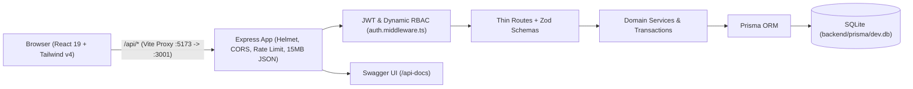

# SI-KDO BMD — Sistem Pengelolaan Kendaraan Dinas Operasional (BPAD DKI)

Aplikasi full-stack manajemen aset **Kendaraan Dinas Operasional (KDO)** sebagai bagian dari tata kelola **Barang Milik Daerah (BMD)** pada lingkungan **BPAD DKI Jakarta**, mencakup inventarisasi kendaraan, monitoring & peminjaman, servis, pengingat pajak/dokumen STNK & BPKB, master pegawai & SKPD, serta RBAC dinamis.

---

## Key Features

- **Dashboard Eksekutif & Pengingat Pajak:** Ringkasan kondisi fisik armada (`BAIK`, `RUSAK_RINGAN`, `RUSAK_BERAT`), status peminjaman aktif, servis berjalan, distribusi aset per SKPD, dan daftar pengingat jatuh tempo PKB/TNKB (`< 30` hari & kedaluwarsa).
- **Inventaris KDO & Riwayat Otomatis:** Pengelolaan data kendaraan, nomor rangka/mesin, lokasi parkir, galeri multi-foto (otomatis dikonversi ke `.webp`), arsip STNK/BPKB (gambar/PDF), serta pencatatan riwayat perubahan otomatis (`PENDAFTARAN`, `PENUGASAN`, `KONDISI`, `MUTASI_SKPD`).
- **Monitoring & Peminjaman Laik Jalan:** Penjadwalan dan peminjaman unit dengan aturan kelayakan ketat (kondisi `BAIK`, tidak sedang servis, pajak aktif, bebas bentrok tanggal) serta alur pengembalian yang menyinkronkan kondisi unit.
- **Servis & Pemeliharaan:** Pencatatan jadwal servis rutin, perbaikan, ganti ban/aki, uji KIR, biaya, bengkel, dan unggah bukti nota.
- **Dokumen & Pajak:** Pemantauan jatuh tempo pajak tahunan (PKB) & plat 5 tahunan (TNKB) serta pratinjau/unduh dokumen STNK & BPKB.
- **Master Data & RBAC Dinamis:** Pengelolaan Perangkat Daerah (SKPD), Pegawai (PNS), Manajemen User, dan Role dinamis dengan matriks izin CRUD per halaman (`read`, `create`, `update`, `delete`).
- **REST API Terdokumentasi Swagger (OpenAPI 3.0.3):** Endpoint `/api-docs` dan `/api-docs.json` siap uji coba interaktif.

---

## Tech Stack

- **Frontend:** React (`^19.3.1`), TypeScript (`~7.0.2`), Vite (`^8.3.6`), Tailwind CSS (`^4.3.5`), React Router DOM (`^7.18.5`), Lucide React (`^1.72.0`), Oxlint (`^1.90.0`)
- **Backend:** Node.js, Express (`^4.21.2`), TypeScript (`^5.8.2`), Zod (`^3.24.2`), JWT (`jsonwebtoken`), Bcrypt (`bcryptjs`), Helmet, Express Rate Limit, Swagger UI Express (`^5.0.1`)
- **Database & ORM:** SQLite, Prisma ORM (`^6.16.0`)
- **Orkestrasi Lokal:** `concurrently` (`^9.1.2`)

---

## Prerequisites

- **Node.js** `>= 20` (teruji pada `v24.22.1`)
- **npm** `>= 10`
- Browser modern (Chrome, Edge, atau Firefox) yang mendukung HTML5 Canvas WebP encoding & `localStorage`

---

## Getting Started

> [!NOTE]
> Di Windows PowerShell 5.1, gunakan titik koma (`;`) sebagai pemisah perintah (bukan `&&`).

1. **Instal dependensi (root, backend, dan frontend):**
   ```powershell
   npm install
   npm --prefix backend install
   npm --prefix frontend install
   ```

2. **Konfigurasi environment variables backend:**
   ```powershell
   Copy-Item backend\.env.example backend\.env
   ```
   Sesuaikan nilai pada `backend/.env` bila diperlukan (lihat tabel Environment Variables di bawah).

3. **Sinkronkan skema database & jalankan seeder awal:**
   ```powershell
   npm --prefix backend run db:generate
   npm run db:push
   npm run db:seed
   ```
   Seeder awal membuat database bersih dengan 1 role `ADMIN_BPAD` dan 1 akun Super Admin default:
   - **Username:** `admin.bpad`
   - **Password:** `admin123`

4. **Jalankan backend dan frontend secara bersamaan:**
   ```powershell
   npm run dev:all
   ```

5. **Akses aplikasi:**
   - **Frontend Web App:** `http://localhost:5173`
   - **Backend REST API:** `http://localhost:3001`
   - **Swagger UI:** `http://localhost:3001/api-docs`
   - **OpenAPI JSON:** `http://localhost:3001/api-docs.json`

---

## Environment Variables

### Backend (`backend/.env`)

| Variable | Description | Default Value / Example |
| :--- | :--- | :--- |
| `PORT` | Port HTTP server backend | `3001` |
| `DATABASE_URL` | Lokasi file SQLite relatif terhadap `backend/prisma/` | `"file:./dev.db"` |
| `JWT_SECRET` | Secret key JWT (wajib diisi saat `NODE_ENV=production`) | `"change-this-secret-in-production"` |
| `JWT_EXPIRES_IN` | Masa berlaku access token JWT | `"12h"` |
| `CORS_ORIGIN` | Daftar origin yang diizinkan (pisahkan koma) | `"http://localhost:5173"` |
| `RATE_LIMIT_WINDOW_MS` | Jendela waktu rate limiter (ms) | `900000` (15 menit) |
| `RATE_LIMIT_MAX` | Batas request `/api/*` per jendela waktu | `10000` (non-prod) / `2000` (prod) |
| `LOGIN_RATE_LIMIT_MAX` | Batas percobaan `/api/auth/login` per jendela waktu | `200` (non-prod) / `50` (prod) |

### Frontend (Opsional)

| Variable | Description | Default Value / Example |
| :--- | :--- | :--- |
| `VITE_API_URL` | Base URL API jika frontend di-host terpisah dari proxy Vite | `/api` |

---

## Architecture & Codebase Structure

Aplikasi menerapkan arsitektur **Monorepo Client-Server**:
- **Frontend SPA** menggunakan pendekatan **Feature-Based Modular** (`features/* -> services/* -> lib/apiClient.ts`) yang berkomunikasi via `/api/*` (diteruskan oleh proxy Vite `:5173 -> :3001`).
- **Backend REST API** menggunakan **Layered Architecture** (`app.ts -> auth.middleware.ts -> routes/* -> schemas/* -> services/* -> Prisma/SQLite`).



```text
bpad-dki/
├── AGENTS.md                         # Panduan coding agent untuk monorepo ini
├── DOCUMENTATION.md                  # Dokumentasi menyeluruh Backend + Frontend
├── README.md                         # Ringkasan proyek & quick start (dokumen ini)
├── package.json                      # Skrip orkestrasi root (dev:all, build, db:*, test:backend)
├── backend/
│   ├── prisma/                       # schema.prisma (8 model), seed.ts, dump.sql, dev.db
│   ├── src/
│   │   ├── docs/                     # Spesifikasi OpenAPI 3.0.3 & setup Swagger UI
│   │   ├── lib/                      # apiResponse, asyncHandler, db, httpError, jwt, password, permissions, serializers, tax
│   │   ├── middleware/               # auth, error, rateLimit, validate
│   │   ├── routes/                   # 10 router Express (/api/health, auth, dashboard, dll.)
│   │   ├── schemas/                  # 9 skema validasi Zod
│   │   ├── services/                 # 9 service domain + transaksi Prisma
│   │   ├── app.ts
│   │   └── index.ts
│   ├── tests/                        # Integration test node:test + fixtures.ts
│   ├── API_DOCUMENTATION.md          # Referensi kontrak endpoint REST API
│   ├── README.md                     # Dokumentasi struktur backend
│   └── SETUP_MANUAL.md               # Panduan setup manual backend
└── frontend/
    ├── src/
    │   ├── components/               # common/* (CustomSelect, Modal, ConfirmDialog, dll.) & layout/AppLayout.tsx
    │   ├── constants/                # domainOptions.ts (merek, jenis servis, golongan, metadata RBAC)
    │   ├── features/                 # 10 modul fitur (auth, dashboard, kendaraan, monitoring, pajak, pegawai, perangkat-daerah, roles, servis, users)
    │   ├── hooks/                    # useAsyncData.ts, useConfirmDelete.ts
    │   ├── lib/                      # apiClient.ts
    │   ├── services/                 # 8 domain API services + barrel bmdService.ts
    │   ├── types/                    # bmd.ts (kontrak DTO TypeScript)
    │   ├── utils/                    # format.ts, vehicleRules.ts, imageUpload.ts
    │   ├── App.tsx                   # Router & guard permission
    │   └── main.tsx
    ├── README.md                     # Dokumentasi arsitektur frontend
    └── SETUP.md                      # Panduan setup & penggunaan frontend
```

---

## Dokumentasi Lengkap

- [**DOCUMENTATION.md**](./DOCUMENTATION.md) — Dokumentasi teknis menyeluruh **Backend + Frontend** (arsitektur end-to-end, ERD 8 tabel, alur RBAC dinamis, aturan bisnis, kontrak API, arsitektur komponen & hooks frontend, pengujian).
- [**AGENTS.md**](./AGENTS.md) — Aturan kerja, konvensi kode, dan checklist verifikasi untuk AI coding agent.
- **Backend Docs:** [backend/README.md](./backend/README.md) · [backend/SETUP_MANUAL.md](./backend/SETUP_MANUAL.md) · [backend/API_DOCUMENTATION.md](./backend/API_DOCUMENTATION.md)
- **Frontend Docs:** [frontend/README.md](./frontend/README.md) · [frontend/SETUP.md](./frontend/SETUP.md)

---

## Pengujian & Verifikasi

```powershell
# Jalankan integration test backend (menggunakan prisma/test.db terisolasi)
npm run test:backend

# Jalankan linter & build produksi frontend
npm --prefix frontend run lint
npm --prefix frontend run build

# Build seluruh backend & frontend
npm run build
```
