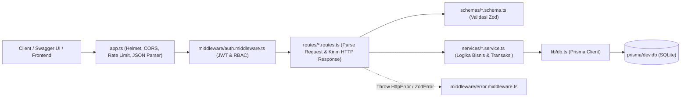

# Backend SI-KDO BMD (`backend/`)

Service backend REST API untuk **Sistem Pengelolaan Kendaraan Dinas Operasional (SI-KDO BMD)** pada **BPAD DKI**. Dibangun dengan arsitektur berlapis (*layered architecture*) menggunakan **Node.js, Express, TypeScript, Prisma ORM (SQLite), Zod, JWT, dan Swagger OpenAPI 3.0.3**.

---

## Dokumentasi Terkait

- **Panduan Setup Manual**: [SETUP_MANUAL.md](./SETUP_MANUAL.md)
- **Referensi Lengkap Endpoint & JSON Contract**: [API_DOCUMENTATION.md](./API_DOCUMENTATION.md)
- **Swagger UI (saat server berjalan)**: `http://localhost:3001/api-docs`
- **OpenAPI Spec JSON**: `http://localhost:3001/api-docs.json`

---

## Alur Request di Dalam Backend



---

## Penjelasan Struktur Folder & File `backend/`

```text
backend/
├── prisma/
│   ├── schema.prisma               # Skema RDBMS (8 model tabel, FK, unique, index)
│   ├── seed.ts                     # Seeder data awal + reset sqlite_sequence (ID mulai dari 1)
│   ├── dump.sql                    # SQL dump lengkap (DDL CREATE TABLE/INDEX + INSERT data awal)
│   └── dev.db                      # File database SQLite lokal (di-ignore Git)
├── src/
│   ├── docs/
│   │   ├── paths/
│   │   │   ├── fleet.paths.ts      # Spesifikasi endpoint /api/kendaraan, /api/peminjaman & /api/servis
│   │   │   ├── master.paths.ts     # Spesifikasi endpoint /api/perangkat-daerah & /api/pegawai
│   │   │   ├── system.paths.ts     # Spesifikasi endpoint /api/health, /api/auth, /api/dashboard
│   │   │   └── users.paths.ts      # Spesifikasi endpoint /api/users & /api/roles
│   │   ├── components.ts           # Skema DTO, securitySchemes (bearerAuth), & response error standar
│   │   ├── helpers.ts              # Helper builder schema & response OpenAPI
│   │   └── swagger.ts              # Perakitan OpenAPI 3.0.3 & mount Swagger UI (/api-docs)
│   ├── lib/
│   │   ├── apiResponse.ts          # Helper envelope JSON sukses (sendSuccess, sendCreated)
│   │   ├── asyncHandler.ts         # Wrapper async Express agar error otomatis diteruskan ke next()
│   │   ├── db.ts                   # Singleton PrismaClient
│   │   ├── httpError.ts            # Kelas HttpError (400, 401, 403, 404, 409)
│   │   ├── jwt.ts                  # Sign & verifikasi JWT Bearer Token
│   │   ├── password.ts             # Hash & verifikasi kata sandi menggunakan bcryptjs
│   │   ├── permissions.ts          # Normalisasi kode role & matriks RolePermissionMap
│   │   ├── serializers.ts          # Parse kolom JSON string (foto/dokumen/permissions) & sembunyikan passwordHash
│   │   └── tax.ts                  # Perhitungan status jatuh tempo PKB tahunan & plat 5 tahunan
│   ├── middleware/
│   │   ├── auth.middleware.ts      # Middleware authenticate (JWT + cek DB) & requirePermission (RBAC dinamis)
│   │   ├── error.middleware.ts     # Global error handler (HttpError, Zod, Prisma, JSON, 413) & 404 handler
│   │   └── validate.middleware.ts  # Parser & validator parameter path :id
│   ├── routes/                     # Thin HTTP route handlers (hanya urus request/response HTTP)
│   │   ├── auth.routes.ts          # /api/auth/login, /me, /logout + login rate limiter
│   │   ├── dashboard.routes.ts     # /api/dashboard
│   │   ├── health.routes.ts        # /api/health
│   │   ├── kendaraan.routes.ts     # /api/kendaraan, /:id, /:id/riwayat
│   │   ├── pegawai.routes.ts       # /api/pegawai, /:id
│   │   ├── peminjaman.routes.ts    # /api/peminjaman, /:id, /:id/complete
│   │   ├── perangkat-daerah.routes.ts # /api/perangkat-daerah, /:id
│   │   ├── roles.routes.ts         # /api/roles, /:id
│   │   ├── servis.routes.ts        # /api/servis, /:id
│   │   └── users.routes.ts         # /api/users, /:id
│   ├── schemas/                    # Skema validasi request body & query parameter (Zod)
│   │   ├── auth.schema.ts
│   │   ├── dashboard.schema.ts
│   │   ├── kendaraan.schema.ts
│   │   ├── pegawai.schema.ts
│   │   ├── peminjaman.schema.ts
│   │   ├── perangkat-daerah.schema.ts
│   │   ├── roles.schema.ts
│   │   ├── servis.schema.ts
│   │   └── user.schema.ts
│   ├── services/                   # Layer aturan bisnis, validasi relasi, & transaksi Prisma
│   │   ├── auth.service.ts
│   │   ├── dashboard.service.ts
│   │   ├── kendaraan.service.ts
│   │   ├── pegawai.service.ts
│   │   ├── peminjaman.service.ts
│   │   ├── perangkat-daerah.service.ts
│   │   ├── roles.service.ts
│   │   ├── servis.service.ts
│   │   └── users.service.ts
│   ├── app.ts                      # Konfigurasi Express app, Helmet, CORS, rate limit, Swagger & routes
│   └── index.ts                    # Entrypoint HTTP server (port 3001) & graceful shutdown
├── tests/
│   └── api.test.ts                 # Integration test otomatis menggunakan node:test
├── dist/                           # Hasil kompilasi TypeScript (dihasilkan oleh npm run build)
├── .env                            # Variabel lingkungan lokal (di-ignore Git)
├── .env.example                    # Template variabel lingkungan
├── .gitignore                      # Pengecualian node_modules, dist, .env, *.db
├── API_DOCUMENTATION.md            # Dokumentasi endpoint REST API & kontrak JSON
├── SETUP_MANUAL.md                 # Panduan setup manual langkah demi langkah
├── package.json                    # Dependensi & skrip NPM backend
└── tsconfig.json                   # Konfigurasi TypeScript (target ES2022, CommonJS, strict)
```

---

## Ringkasan Skrip NPM (`backend/package.json`)

| Perintah | Fungsi |
|---|---|
| `npm run dev` | Menjalankan server mode development dengan `tsx watch` |
| `npm run build` | Mengompilasi TypeScript (`src/`) ke `dist/` |
| `npm run start` | Menjalankan server hasil build (`node dist/index.js`) |
| `npm run db:generate` | Menghasilkan Prisma Client dari `prisma/schema.prisma` |
| `npm run db:push` | Menyinkronkan skema Prisma ke database SQLite `prisma/dev.db` |
| `npm run db:seed` | Mengisi data awal realistis ke database (`prisma/seed.ts`) |
| `npm run db:reset` | Reset total database SQLite dan menjalankan ulang seed |
| `npm test` | Menjalankan suite integration test (`tests/api.test.ts`) |
