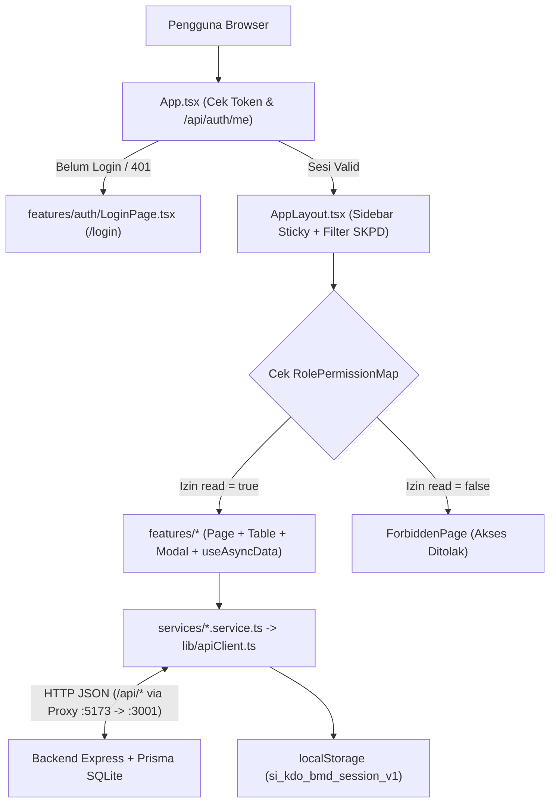

# Frontend SI-KDO BMD (`frontend/`)

Dokumentasi teknis antarmuka web **Sistem Pengelolaan Kendaraan Dinas Operasional (SI-KDO BMD)** untuk **BPAD DKI Jakarta**. Aplikasi ini dibangun sebagai Single-Page Application (SPA) dengan React, TypeScript, Vite, dan Tailwind CSS v4.

> Untuk langkah instalasi dari nol, akun demo bawaan, serta panduan troubleshooting lokal, lihat [**SETUP.md**](./SETUP.md).

---

## Ringkasan Fitur

- **Autentikasi & RBAC Dinamis (`/login`, `/roles`, `/users`)**
  - Mendukung multi-role (`ADMIN_BPAD`, `OPERATOR_SKPD`, `VIEWER`, serta role kustom dari `/roles`).
  - Matriks hak akses granular (`Lihat`, `Tambah`, `Ubah`, `Hapus`) per modul halaman.
  - Manajemen akun pengguna dilengkapi toggle interaktif aktif/nonaktif (`role="switch"`) dan proteksi agar akun yang sedang login tidak menonaktifkan dirinya sendiri.
- **Dashboard Eksekutif (`/`)**
  - Ringkasan kondisi fisik armada (`BAIK`, `RUSAK_RINGAN`, `RUSAK_BERAT`), status peminjaman aktif, pengingat pajak PKB/TNKB < 30 hari & terlambat, servis aktif, serta distribusi unit per SKPD.
- **Inventaris Kendaraan Dinas (`/kendaraan`)**
  - Tabel ringkas & kartu mobile; mengklik **plat nomor** membuka modal detail lengkap (nomor rangka, nomor mesin, lokasi parkir terpisah, galeri multi-foto, serta pratinjau dokumen STNK & BPKB).
  - Dropdown merek kendaraan terkurasi + opsi *Lainnya*, serta konversi otomatis seluruh foto unggahan (`JPG`, `JPEG`, `PNG`, `WebP`) ke format **`.webp`**.
- **Monitoring & Peminjaman Kendaraan (`/monitoring`)**
  - Memantau status operasional live tiap unit (*Siap Dipinjam*, *Sedang Dipinjam*, *Terjadwal*, *Dalam Servis*, *Diblokir*).
  - **Aturan Kelayakan Ketat (`evaluateVehicleBorrowStatus`)**: Hanya unit berkondisi **`BAIK`**, tidak sedang **`DALAM_PERBAIKAN`**, dan tidak menunggak pajak (`OVERDUE`) yang dapat dipilih untuk peminjaman. Deteksi bentrok tanggal pinjam & fitur pengembalian unit yang menyinkronkan kondisi unit ke master KDO.
- **Servis & Pemeliharaan (`/servis`)**
  - Pencatatan jadwal servis berkala, perbaikan, penggantian suku cadang, biaya, bengkel pelaksana, serta pratinjau nota/kuitansi.
- **Dokumen & Pajak Kendaraan (`/pajak-dokumen`)**
  - Pelacakan jatuh tempo Pajak Tahunan (PKB) & Pajak Plat 5 Tahunan (TNKB) serta kelengkapan dokumen STNK dan BPKB beserta viewer langsung (`DocumentViewerModal`).
- **Master Pegawai PNS & Perangkat Daerah (`/pegawai`, `/perangkat-daerah`)**
  - Pengelolaan data penanggung jawab KDO beserta golongan/pangkat dan profil SKPD pemilik aset.
- **Komponen UI Terstandar**
  - Tema konsisten petrol-teal (`#0a3649`) dan aksen biru (`#2563eb` / `#1d4ed8`).
  - Seluruh dropdown memakai [`CustomSelect.tsx`](./src/components/common/CustomSelect.tsx) berbasis React Portal (tidak memakai popup `<select>` bawaan OS), mendukung pencarian untuk daftar ≥ 7 opsi, indikator titik status, navigasi keyboard, dan posisi anti-terpotong di dalam modal.

---

## Tech Stack

Sesuai konfigurasi pada [`package.json`](./package.json) dan [`vite.config.ts`](./vite.config.ts):

| Kategori | Paket / Teknologi | Versi |
|---|---|---|
| Framework UI | `react`, `react-dom` | `^19.3.1` |
| Routing | `react-router-dom` | `^7.18.5` |
| Styling | `tailwindcss`, `@tailwindcss/vite` | `^4.3.5` |
| Ikon | `lucide-react` | `^1.72.0` |
| Build Tool & Dev Server | `vite`, `@vitejs/plugin-react` | `^8.3.6`, `^6.1.2` |
| Bahasa & Type Checker | `typescript` | `~7.0.2` |
| Linter | `oxlint` | `^1.90.0` |

---

## Arsitektur & Struktur Direktori

Frontend menggunakan arsitektur **Feature-Based Modular** (*Pages/Features → Custom Hooks → Domain Services → Shared API Client → Backend REST API*) yang terhubung penuh ke server Express + Prisma (`backend/`) menggunakan autentikasi JWT Bearer dan penyimpanan sesi browser (`localStorage`).

```text
frontend/
├── index.html                        # Entry HTML (title & font Plus Jakarta Sans / JetBrains Mono)
├── package.json                      # Dependensi & skrip NPM frontend
├── vite.config.ts                    # Konfigurasi Vite, Tailwind plugin, port 5173 & proxy /api -> :3001
├── .oxlintrc.json                    # Aturan linter oxlint (react, typescript, oxc)
├── tsconfig*.json                    # Konfigurasi TypeScript
├── README.md                         # Dokumentasi arsitektur & modul frontend (dokumen ini)
├── SETUP.md                          # Manual setup lokal, akun demo, & troubleshooting
└── src/
    ├── main.tsx                      # Bootstrap React root & styles
    ├── index.css                     # Import Tailwind CSS v4 & token tema dasar
    ├── App.tsx                       # Router utama, sinkronisasi sesi /api/auth/me, dan proteksi RBAC
    ├── lib/
    │   └── apiClient.ts              # Fetch client terpusat (/api/*), JWT header, sesi localStorage, & event 401
    ├── constants/
    │   └── domainOptions.ts          # Konstanta domain (merek, jenis servis, golongan PNS, lokasi parkir, matriks RBAC)
    ├── hooks/
    │   ├── useAsyncData.ts           # Hook pemuatan data asinkron generik (loading, error, reload)
    │   └── useConfirmDelete.ts       # Hook status & eksekusi dialog konfirmasi hapus generik
    ├── types/
    │   └── bmd.ts                    # Kontrak TypeScript DTO backend (Kendaraan, Peminjaman, Servis, Role, User, dll.)
    ├── services/
    │   ├── bmdService.ts             # Barrel re-export untuk kompatibilitas impor lintas modul
    │   ├── auth.service.ts           # Login, refresh /api/auth/me, dan manajemen sesi
    │   ├── dashboard.service.ts      # Ringkasan eksekutif dashboard (/api/dashboard)
    │   ├── kendaraan.service.ts      # CRUD KDO & riwayat kendaraan
    │   ├── master.service.ts         # CRUD Perangkat Daerah & Pegawai (PNS)
    │   ├── peminjaman.service.ts     # CRUD peminjaman & pengembalian kendaraan
    │   ├── rbac.service.ts           # CRUD User & Role/RBAC
    │   └── servis.service.ts         # CRUD catatan servis & pemeliharaan
    ├── utils/
    │   ├── format.ts                 # Formatter tanggal/NIP/rupiah/label murni
    │   ├── vehicleRules.ts           # Aturan bisnis status pajak (getTaxStatus) & kelayakan pinjam
    │   └── imageUpload.ts            # Konversi gambar ke WebP, resize maks 960px, & pembacaan dokumen PDF/gambar
    ├── components/
    │   ├── layout/
    │   │   └── AppLayout.tsx         # Sidebar sticky navigasi, filter global SKPD, & topbar sesi pengguna
    │   └── common/
    │       ├── ConfirmDialog.tsx     # Dialog konfirmasi aksi destruktif
    │       ├── CustomSelect.tsx      # Komponen dropdown kustom + keyboard navigation & form validation bridge
    │       ├── CustomSelectMenu.tsx  # Panel Portal daftar opsi & pencarian untuk CustomSelect
    │       ├── DocumentViewerModal.tsx # Modal pratinjau gambar & PDF serta unduhan file
    │       ├── FeedbackBanner.tsx    # Banner notifikasi sukses/error standar yang dapat ditutup
    │       ├── KondisiBadge.tsx      # Badge semantik kondisi fisik KDO
    │       ├── Modal.tsx             # Wrapper modal responsif dengan penanganan Escape
    │       ├── StateViews.tsx        # Komponen LoadingState, EmptyState, dan ErrorState
    │       └── StatusBadges.tsx      # Badge status peminjaman & status servis terstandar
    └── features/                     # Modul fitur terpisah per domain (Page orchestrator, Table/Grid, FormModal, DetailModal)
        ├── auth/                     # LoginPage.tsx
        ├── dashboard/                # DashboardPage.tsx, DashboardSkpdSection.tsx, DashboardHistorySection.tsx
        ├── kendaraan/                # KendaraanPage, KendaraanTable, KendaraanFormModal, KendaraanDetailModal, kendaraanFormUtils
        ├── monitoring/               # MonitoringPage, FleetStatusSection, PeminjamanTable, PeminjamanFormModal, ReturnVehicleModal, PeminjamanDetailModal
        ├── pajak/                    # PajakDokumenPage.tsx, PajakTable.tsx
        ├── pegawai/                  # PegawaiPage, PegawaiTable, PegawaiFormModal, PegawaiDetailModal
        ├── perangkat-daerah/         # PerangkatDaerahPage, PerangkatDaerahGrid, PerangkatDaerahFormModal, PerangkatDaerahDetailModal
        ├── roles/                    # RolesPage, RoleCardList, RoleFormModal
        ├── servis/                   # ServisPage, ServisTable, ServisFormModal, ServisDetailModal
        └── users/                    # UsersPage, UsersTable, UserFormModal, UserStatusSwitch
```

### Alur Otorisasi, Routing, & Data



---

## Rute & Izin Modul (`App.tsx`)

| Rute | Halaman | Permission Key | Keterangan |
|---|---|---|---|
| `/login` | `LoginPage` | *(Publik)* | Masuk ke aplikasi & isi cepat kredensial demo |
| `/` | `DashboardPage` | `dashboard` | Ringkasan armada, status pinjam, servis, & pengingat pajak |
| `/kendaraan` | `KendaraanPage` | `kendaraan` | Inventaris KDO, detail plat nomor, multi-foto WebP, STNK/BPKB |
| `/monitoring` | `MonitoringPage` | `peminjaman` | Monitoring unit live & transaksi peminjaman/pengembalian KDO |
| `/servis` | `ServisPage` | `servis` | Pencatatan servis/perbaikan & pratinjau nota |
| `/pajak-dokumen` | `PajakDokumenPage` | `pajakDokumen` | Pengingat pajak tahunan/5 tahunan & kelengkapan dokumen |
| `/pegawai` | `PegawaiPage` | `pegawai` | Master PNS penanggung jawab |
| `/perangkat-daerah` | `PerangkatDaerahPage` | `perangkatDaerah` | Master SKPD / Perangkat Daerah |
| `/users` | `UsersPage` | `users` | Manajemen akun pengguna & toggle aktif/nonaktif |
| `/roles` | `RolesPage` | `roles` | Pengaturan peran & matriks hak akses CRUD |

---

## Sesi Autentikasi, Upload Media, & Integrasi API Backend

### 1. Sesi `localStorage` & Autentikasi JWT (`src/lib/apiClient.ts` & `src/services/auth.service.ts`)

| Key | Fungsi |
|---|---|
| `si_kdo_bmd_session_v1` | Menyimpan sesi login aktif (`AuthSession`: `token` JWT, profil user, `roleName`, dan `permissions`). |

Seluruh data entitas (`PerangkatDaerah`, `Pegawai`, `Kendaraan`, `Riwayat`, `Servis`, `Peminjaman`, `Users`, `Roles`) diambil dan disimpan secara real-time melalui REST API backend (`/api/*`) via modul service terpisah (`src/services/*.service.ts`) dengan header `Authorization: Bearer <token>`. Jika server mengembalikan HTTP `401`, interceptor di [`apiClient.ts`](./src/lib/apiClient.ts) menghapus sesi lokal dan memicu event `AUTH_UNAUTHORIZED_EVENT` agar pengguna diarahkan kembali ke halaman login.

### 2. Aturan Pemrosesan Media (`src/utils/imageUpload.ts`)

- **Foto Kendaraan**: Menerima `.jpg`, `.jpeg`, `.png`, `.webp` maksimal **`5 MB`**, di-resize proporsional maksimal **`960px`**, lalu otomatis dikonversi di browser menggunakan HTML Canvas menjadi **`.webp`** (kualitas `0.8`).
- **Dokumen STNK, BPKB, & Nota Servis**: Menerima gambar (otomatis dikonversi ke `.webp`) atau file **PDF** dengan batas maksimal **`1.5 MB`** (dikirim sebagai data URI Base64 dalam limit payload JSON backend **`15 MB`**).

### 3. Konfigurasi Server, Proxy, & `VITE_API_URL`

Dev server Vite berjalan di port **`5173`** dan meneruskan request dengan prefix **`/api`** ke **`http://localhost:3001`** (`changeOrigin: true`) sesuai [`vite.config.ts`](./vite.config.ts). Secara opsional, atur environment variable `VITE_API_URL` jika frontend di-host terpisah dari server API backend.

---

## Skrip NPM Frontend

Jalankan di dalam direktori `frontend/` (atau dengan `npm --prefix frontend run <script>` dari root repo):

| Perintah | Aksi |
|---|---|
| `npm run dev` | Menjalankan Vite development server dengan HMR di `http://localhost:5173` |
| `npm run build` | Menjalankan type-check TypeScript (`tsc -b`) dan bundle produksi ke `frontend/dist/` (`vite build`) |
| `npm run lint` | Menjalankan `oxlint` pada seluruh berkas sumber |
| `npm run preview` | Menjalankan pratinjau hasil build produksi secara lokal |
