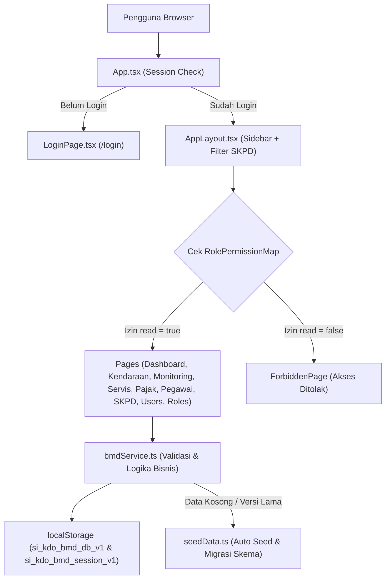

# Frontend SI-KDO BMD (`frontend/`)

Dokumentasi teknis antarmuka web **Sistem Pengelolaan Kendaraan Dinas Operasional (SI-KDO BMD)** untuk **BPAD DKI Jakarta**. Aplikasi ini dibangun sebagai Single-Page Application (SPA) dengan React, TypeScript, Vite, dan Tailwind CSS v4.

> Untuk langkah instalasi dari nol, akun demo bawaan, serta panduan troubleshooting lokal, lihat [**SETUP.md**](./SETUP.md).

---

## Ringkasan Fitur

- **Autentikasi & RBAC Dinamis (`/login`, `/roles`, `/users`)**
  - Mendukung multi-role (`ADMIN_BPAD`, `OPERATOR_SKPD`, `VIEWER`, serta role kustom dari `/roles`).
  - Matriks hak akses granular (`Lihat`, `Tambah`, `Ubah`, `Hapus`) per modul halaman.
  - Manajemen akun pengguna dilengkapi toggle interaktif aktif/nonaktif (`role="switch"`) dan proteksi agar akun yang sedang login tidak menonaktifkan dirinya sendiri.
- **Dashboard Eksekutif (`/`)**
  - Ringkasan kondisi fisik armada (`BAIK`, `RUSAK_RINGAN`, `RUSAK_BERAT`), status peminjaman aktif, pengingat pajak PKB/TNKB < 30 hari & terlambat, servis aktif, serta distribusi unit per SKPD.
- **Inventaris Kendaraan Dinas (`/kendaraan`)**
  - Tabel ringkas & kartu mobile; mengklik **plat nomor** membuka modal detail lengkap (nomor rangka, nomor mesin, lokasi parkir terpisah, galeri multi-foto, serta pratinjau dokumen STNK & BPKB).
  - Dropdown merek kendaraan terkurasi + opsi *Lainnya*, serta konversi otomatis seluruh foto unggahan (`JPG`, `JPEG`, `PNG`, `WebP`) ke format **`.webp`**.
- **Monitoring & Peminjaman Kendaraan (`/monitoring`)**
  - Memantau status operasional live tiap unit (*Siap Dipinjam*, *Sedang Dipinjam*, *Terjadwal*, *Dalam Servis*, *Diblokir*).
  - **Aturan Kelayakan Ketat (`evaluateVehicleBorrowStatus`)**: Hanya unit berkondisi **`BAIK`**, tidak sedang **`DALAM_PERBAIKAN`**, dan tidak menunggak pajak (`OVERDUE`) yang dapat dipilih untuk peminjaman. Deteksi bentrok tanggal pinjam & fitur pengembalian unit yang menyinkronkan kondisi unit ke master KDO.
- **Servis & Pemeliharaan (`/servis`)**
  - Pencatatan jadwal servis berkala, perbaikan, penggantian suku cadang, biaya, bengkel pelaksana, serta pratinjau nota/kuitansi.
- **Dokumen & Pajak Kendaraan (`/pajak-dokumen`)**
  - Pelacakan jatuh tempo Pajak Tahunan (PKB) & Pajak Plat 5 Tahunan (TNKB) serta kelengkapan dokumen STNK dan BPKB beserta viewer langsung (`DocumentViewerModal`).
- **Master Pegawai PNS & Perangkat Daerah (`/pegawai`, `/perangkat-daerah`)**
  - Pengelolaan data penanggung jawab KDO beserta golongan/pangkat dan profil SKPD pemilik aset.
- **Komponen UI Terstandar**
  - Tema konsisten petrol-teal (`#0a3649`) dan aksen biru (`#2563eb` / `#1d4ed8`).
  - Seluruh dropdown memakai [`CustomSelect.tsx`](./src/components/common/CustomSelect.tsx) berbasis React Portal (tidak memakai popup `<select>` bawaan OS), mendukung pencarian untuk daftar ≥ 7 opsi, indikator titik status, navigasi keyboard, dan posisi anti-terpotong di dalam modal.

---

## Tech Stack

Sesuai konfigurasi pada [`package.json`](./package.json) dan [`vite.config.ts`](./vite.config.ts):

| Kategori | Paket / Teknologi | Versi |
|---|---|---|
| Framework UI | `react`, `react-dom` | `^19.3.1` |
| Routing | `react-router-dom` | `^7.18.5` |
| Styling | `tailwindcss`, `@tailwindcss/vite` | `^4.3.5` |
| Ikon | `lucide-react` | `^1.72.0` |
| Build Tool & Dev Server | `vite`, `@vitejs/plugin-react` | `^8.3.6`, `^6.1.2` |
| Bahasa & Type Checker | `typescript` | `~7.0.2` |
| Linter | `oxlint` | `^1.90.0` |

---

## Arsitektur & Struktur Direktori

Frontend menggunakan arsitektur berlapis (*UI Pages → Service Layer → Persistence / Seed*) dengan penyimpanan lokal browser (`localStorage`) dan dukungan skema tipe terpusat.

```text
frontend/
├── index.html                        # Entry HTML (title & font Plus Jakarta Sans / JetBrains Mono)
├── package.json                      # Dependensi & skrip NPM frontend
├── vite.config.ts                    # Konfigurasi Vite, Tailwind plugin, port 5173 & proxy /api -> :3001
├── .oxlintrc.json                    # Aturan linter oxlint (react, typescript, oxc)
├── tsconfig*.json                    # Konfigurasi TypeScript
├── README.md                         # Dokumentasi arsitektur & modul frontend (dokumen ini)
├── SETUP.md                          # Manual setup lokal, akun demo, & troubleshooting
└── src/
    ├── main.tsx                      # Bootstrap React root & styles
    ├── index.css                     # Import Tailwind CSS v4 & token tema dasar
    ├── App.tsx                       # Router utama, session guard, dan proteksi RBAC per route
    ├── types/
    │   └── bmd.ts                    # Kontrak TypeScript (Kendaraan, Peminjaman, Servis, Role, User, dll.)
    ├── data/
    │   └── seedData.ts               # Data awal demo (SKPD, PNS, KDO, Riwayat, Servis, Peminjaman, Roles, Users)
    ├── services/
    │   └── bmdService.ts             # CRUD, validasi kelayakan pinjam, agregasi dashboard, auth, & migrasi localStorage
    ├── utils/
    │   ├── format.ts                 # Formatter tanggal/NIP/rupiah, konstanta opsi, & evaluateVehicleBorrowStatus
    │   └── imageUpload.ts            # Konversi gambar ke WebP, resize maks 960px, & pembacaan dokumen PDF/gambar
    └── components/
        ├── layout/
        │   └── AppLayout.tsx         # Sidebar navigasi, filter global SKPD, topbar, & tombol reset seed
        └── common/
            ├── ConfirmDialog.tsx     # Dialog konfirmasi aksi destruktif/reset
            ├── CustomSelect.tsx      # Komponen dropdown kustom berbasis Portal + pencarian + keyboard nav
            ├── DocumentViewerModal.tsx # Modal pratinjau gambar & PDF serta unduhan file
            ├── KondisiBadge.tsx      # Badge semantik kondisi fisik KDO
            ├── Modal.tsx             # Wrapper modal responsif dengan penanganan Escape
            └── StateViews.tsx        # Komponen LoadingState, EmptyState, dan ErrorState
```

### Alur Otorisasi, Routing, & Data



---

## Rute & Izin Modul (`App.tsx`)

| Rute | Halaman | Permission Key | Keterangan |
|---|---|---|---|
| `/login` | `LoginPage` | *(Publik)* | Masuk ke aplikasi & isi cepat kredensial demo |
| `/` | `DashboardPage` | `dashboard` | Ringkasan armada, status pinjam, servis, & pengingat pajak |
| `/kendaraan` | `KendaraanPage` | `kendaraan` | Inventaris KDO, detail plat nomor, multi-foto WebP, STNK/BPKB |
| `/monitoring` | `MonitoringPage` | `peminjaman` | Monitoring unit live & transaksi peminjaman/pengembalian KDO |
| `/servis` | `ServisPage` | `servis` | Pencatatan servis/perbaikan & pratinjau nota |
| `/pajak-dokumen` | `PajakDokumenPage` | `pajakDokumen` | Pengingat pajak tahunan/5 tahunan & kelengkapan dokumen |
| `/pegawai` | `PegawaiPage` | `pegawai` | Master PNS penanggung jawab |
| `/perangkat-daerah` | `PerangkatDaerahPage` | `perangkatDaerah` | Master SKPD / Perangkat Daerah |
| `/users` | `UsersPage` | `users` | Manajemen akun pengguna & toggle aktif/nonaktif |
| `/roles` | `RolesPage` | `roles` | Pengaturan peran & matriks hak akses CRUD |

---

## Penyimpanan Data, Upload Media, & Konfigurasi Proxy

### 1. Kunci `localStorage` (`src/services/bmdService.ts`)

| Key | Fungsi |
|---|---|
| `si_kdo_bmd_db_v1` | Menyimpan seluruh koleksi entitas aplikasi (`perangkatDaerah`, `pegawai`, `kendaraan`, `riwayat`, `servis`, `peminjaman`, `roles`, `users`, `nextIds`). |
| `si_kdo_bmd_session_v1` | Menyimpan sesi login aktif (`AuthSession`). |

Saat `readDb()` dijalankan pada data lama, sistem otomatis melakukan migrasi non-destruktif untuk menambahkan koleksi/field baru seperti `servis`, `peminjaman`, `roles`, `users`, `fotos[]`, `lokasiParkir`, maupun izin role baru.

### 2. Aturan Pemrosesan Media (`src/utils/imageUpload.ts`)

- **Foto Kendaraan**: Menerima `.jpg`, `.jpeg`, `.png`, `.webp` maksimal **`5 MB`**, di-resize proporsional maksimal **`960px`**, lalu otomatis dikonversi di browser menggunakan HTML Canvas menjadi **`.webp`** (kualitas `0.8`).
- **Dokumen STNK, BPKB, & Nota Servis**: Menerima gambar (otomatis dikonversi ke `.webp`) atau file **PDF** dengan batas maksimal **`1.5 MB`** agar muat di penyimpanan lokal browser.

### 3. Konfigurasi Server & Proxy (`vite.config.ts`)

Dev server Vite berjalan di port **`5173`** dan meneruskan request dengan prefix **`/api`** ke **`http://localhost:3001`** (`changeOrigin: true`). Pada kondisi default frontend saat ini, seluruh operasi UI berinteraksi dengan [`bmdService.ts`](./src/services/bmdService.ts) (`localStorage`).

---

## Skrip NPM Frontend

Jalankan di dalam direktori `frontend/` (atau dengan `npm --prefix frontend run <script>` dari root repo):

| Perintah | Aksi |
|---|---|
| `npm run dev` | Menjalankan Vite development server dengan HMR di `http://localhost:5173` |
| `npm run build` | Menjalankan type-check TypeScript (`tsc -b`) dan bundle produksi ke `frontend/dist/` (`vite build`) |
| `npm run lint` | Menjalankan `oxlint` pada seluruh berkas sumber |
| `npm run preview` | Menjalankan pratinjau hasil build produksi secara lokal |
